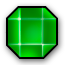

<p align="center">
  <br>
  
  
  
  
  
  
  
</p>

# Freegemas — four ports, one gem board

Freegemas is an open-source version of the well-known **Bejeweled**, written in
C++ with [SDL3](https://www.libsdl.org/).  The original project is
[JoseTomasTocino/freegemas](https://github.com/JoseTomasTocino/freegemas); this
fork adds native WebAssembly, A2VERA (Apple //e with VERA), Commander X16 and
Apple IIgs ports, plus browser players for all four targets.

**Play in a browser:** <https://anomixer.github.io/freegemas/>

## Play in your browser

Every target has a browser player.  The native WebAssembly and X16 players are
built from this repository and served from its GitHub Pages site; the two Apple
II players use dedicated browser emulators.

| Target | Play | What runs there |
| --- | --- | --- |
| **Landing page** | **[OPEN THE PLAYER SELECTOR](https://anomixer.github.io/freegemas/)** | the four cards below, with local WebAssembly and X16 players |
| **Native WebAssembly** | **[PLAY HERE](https://anomixer.github.io/freegemas/wasm/)** | the original C++/SDL3 game compiled with Emscripten; WebGL rendering and Web Audio sound |
| **Commander X16** | **[PLAY HERE](https://anomixer.github.io/freegemas/x16/)** | the 65C02S + VERA port under the official X16Community x16emu WebAssembly r49, booting the same `hostfs/` files as native x16emu |
| **A2VERA (Apple //e + VERA)** | **[PLAY HERE](https://apple2ts.com/?slot2=vera&tab=vera#https://raw.githubusercontent.com/anomixer/freegemas/master/vera/freegemas.hdv)** | Apple2TS streaming [`vera/freegemas.hdv`](vera/freegemas.hdv); VERA must be in slot 2 or 4 |
| **Apple IIgs** | **[PLAY HERE](https://a2gsemu-ia.pages.dev/?lang=en&game=https%3A%2F%2Fgithub.com%2Fanomixer%2Ffreegemas)** | a2gsemu-ia booting the IIgs 2MG release from this repository |

The four ports share the same board, gem art, menu flow and rules.  Browser
audio needs a click before it can start; the native desktop build is still the
way to run the game without an emulator or WASM runtime.

## Ports at a glance

| Directory | Target | Deliverable / build |
| --- | --- | --- |
| [`platform/wasm/`](platform/wasm/) | Native C++ / WebAssembly | `build-wasm/` — Emscripten build, published as `/freegemas/wasm/` |
| [`x16/`](x16/) | Commander X16 (65C02S + VERA) | `x16/hostfs/boot.prg`; browser build in `x16/web/dist/`, published as `/freegemas/x16/` |
| [`vera/`](vera/) | Apple //e / IIe with a VERA card | [`vera/freegemas.hdv`](vera/freegemas.hdv) — 2 MB ProDOS image, streamed by Apple2TS |
| [`iigs/`](iigs/) | Apple IIgs (65816, Super Hi-Res) | [`iigs/merlin32/build/freegemas.2mg`](iigs/merlin32/build/freegemas.2mg) — bootable 2MG image |
| [`web/`](web/) | GitHub Pages landing page | assembles the four cards and copies the WASM + X16 players into `web/_site/` |
| `src/`, `include/`, `media/`, `vendor/` | original desktop game | the C++/SDL3 sources, headers and bundled dependencies |

## Browser site build

The landing page is maintained in [`web/`](web/).  It does not compile the
ports itself; build them first, then assemble the static site:

```bash
# 1. Native WebAssembly (requires the Emscripten SDK)
./platform/wasm/build.sh

# 2. Commander X16 browser player (Node.js 20+)
node ./x16/web/build.mjs

# 3. Landing page and both players
node ./web/build-site.mjs
```

On Windows use `platform\wasm\build.ps1` for step 1; the other commands are the
same. The result is `web/_site/`; serve it over HTTP, for example:

```bash
python3 -m http.server 8123 --directory web/_site
```

The GitHub Actions workflow
[`.github/workflows/deploy-wasm.yml`](.github/workflows/deploy-wasm.yml)
builds the same three pieces on pushes to `master` and publishes `web/_site/`
to GitHub Pages.  See [`web/README.md`](web/README.md) and
[`web/README-tw.md`](web/README-tw.md) for the site layout and deployment
details.

The deployed paths are:

- landing page: `https://anomixer.github.io/freegemas/`
- native WebAssembly: `https://anomixer.github.io/freegemas/wasm/`
- Commander X16: `https://anomixer.github.io/freegemas/x16/`

A2VERA and IIgs are external browser emulators, so they are linked directly and
are not copied into `web/_site/`.

## Commander X16 port

The X16 port lives in [`x16/`](x16/).  It is 65C02 code built with the
[LLVM-MOS SDK](https://github.com/llvm-mos/llvm-mos-sdk), with a resident loader
and overlays, a 320×240 8bpp VERA bitmap, persistent hardware gem sprites and
the original five signed 8-bit PCM effects.  Music is a **16-bit mono
8,010.864 Hz ZCM** stream read from `hostfs/music.zcm` through KERNAL `MACPTR`,
mixed with the effects into the 16-bit FIFO; music can be disabled from Options.
High scores persist through HostFS.

The browser player in [`x16/web/`](x16/web/) boots the same `hostfs/` build
under the official x16emu WebAssembly r49.  Native validation and the browser
player both use x16emu r49; neither is real-hardware validation.  See
[`x16/README.md`](x16/README.md), [`x16/README-tw.md`](x16/README-tw.md) and
[`x16/web/README.md`](x16/web/README.md).

## A2VERA port (Apple //e + VERA)

The VERA port lives in [`vera/`](vera/).  It uses LLVM-MOS 65C02 code, a
320×240 8bpp bitmap with hardware gem sprites and a 2 MB ProDOS HDV.  It offers
streamed 8-bit PCM music or the preloaded PSG arrangement, with five PCM sound
effects in VERA VRAM; the segmented loader covers title, game, instructions and
options.  See [`vera/README.md`](vera/README.md) and
[`vera/AGENTS.md`](vera/AGENTS.md).

Browser play uses Apple2TS and the HDV from this repository.  This is browser
emulation, not a claim of new real-hardware testing in this change.

## Apple IIgs port

The IIgs port lives in [`iigs/`](iigs/).  It is a 320×200 Super Hi-Res game
built with Merlin32, with VERA-inspired title, How-to-Play and Options screens,
DOC music streamed through alternating 4 KiB wave tables, and separate DOC
oscillator pairs for effects.  The deliverable is the bootable
[`freegemas.2mg`](iigs/merlin32/build/freegemas.2mg) image; GS/OS and Ensoniq
DOC audio are required.  See [`iigs/README.md`](iigs/README.md) and
[`iigs/AGENTS.md`](iigs/AGENTS.md) for build steps and the current validation
caveats.

Browser play uses a2gsemu-ia.  This page does not imply that the IIgs port was
newly tested on real hardware.

## Native desktop builds

The original desktop game is built from the repository root. SDL3, SDL3_mixer,
SDL3_ttf and jsoncpp are built from the bundled submodules, so only the system
development headers they need have to be installed. On Debian-based GNU/Linux
systems:

```bash
sudo apt-get install git build-essential cmake \
  zlib1g-dev libasound2-dev libxkbcommon-dev libdrm-dev libgl1-mesa-dev \
  libgbm-dev libwayland-dev libdecor-0-dev

git clone --recursive https://github.com/anomixer/freegemas.git
cd freegemas
mkdir build && cd build
cmake ..
cmake --build .
./freegemas
```

On macOS, Homebrew is only needed for CMake:

```bash
brew install cmake
```

Then build and install the app bundle:

```bash
cmake -S . -B build -DCMAKE_BUILD_TYPE=Release -DCMAKE_INSTALL_PREFIX="$PWD/dist"
cmake --build build
strip build/freegemas.app/Contents/MacOS/freegemas
cmake --install build
open dist/freegemas.app
```

### Building a universal app

The executable has no third-party dylib dependencies. SDL3, SDL3_mixer,
SDL3_ttf (including freetype) and JsonCpp are built as static archives from the
submodules and linked into the binary, so `Contents/MacOS/freegemas` carries
everything it needs and `Contents/Frameworks` stays empty. The only libraries
it loads are Apple's own, from `/usr/lib` and `/System/Library`.

Build one bundle that runs on both Apple Silicon and Intel with:

```bash
cmake -S . -B build -DCMAKE_BUILD_TYPE=Release \
    -DCMAKE_OSX_ARCHITECTURES="arm64;x86_64" \
    -DCMAKE_INSTALL_PREFIX="$PWD/dist"
cmake --build build -j"$(sysctl -n hw.ncpu)"
strip build/freegemas.app/Contents/MacOS/freegemas
cmake --install build
open dist/freegemas.app
```

The original PlayStation Vita build is also retained:

```bash
mkdir vita && cd vita
cmake -DCMAKE_TOOLCHAIN_FILE="${VITASDK}/share/vita.toolchain.cmake" ..
make
```

This produces `freegemas.vpk`, which can be transferred and installed on a Vita.

## Music licensing

The music in the game is [Easy Lemon by Kevin MacLeod](https://incompetech.com/music/royalty-free/index.html?isrc=USUAN1200076),
licensed under [Creative Commons: By Attribution 3.0](https://creativecommons.org/licenses/by/3.0/).

## Validation scope

The browser landing page, the local static build flow and the four player cards
are website work.  The native WebAssembly and X16 WebAssembly players are built
by GitHub Actions; their generated files are not committed.  A2VERA and IIgs
run through their external browser emulators.  The port-specific READMEs record
the emulator and real-hardware validation status separately; nothing in this
page replaces testing on a physical Commander X16, Apple //e VERA or Apple IIgs.
