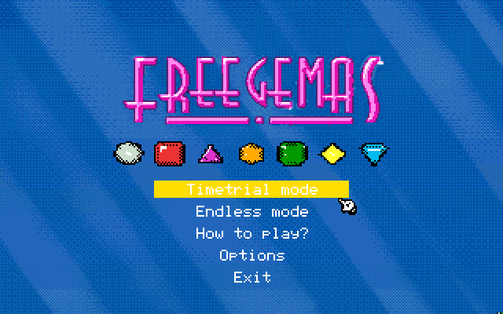
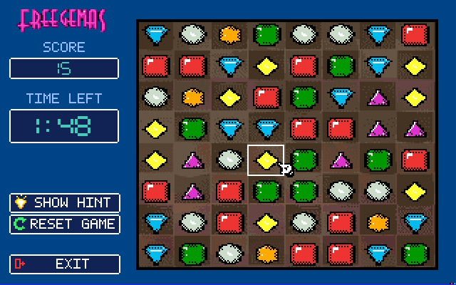

# Freegemas for Apple IIGS

[English](README.md) | 繁體中文

<p align="center">
  
  
</p>

這是 Freegemas 的 Apple IIGS 移植版。遊戲以 65816 原生組語撰寫（使用 Merlin32），運行於 GS/OS 環境（S16 可執行檔）。畫面使用 320×200 Super Hi-Res（4bpp）與逐行 16 色調色盤。棋盤採用完整 8 列對稱邊界、對齊原作的木質紋理，以及使用者核定之精緻 2D 方塊像素寶石。音訊透過 Ensoniq 5503 DOC 晶片提供雙緩衝背景音樂與原生 PCM 音效。

可開機測試的 2MG 磁碟映像建置於 [`merlin32/build/freegemas.2mg`](merlin32/build/freegemas.2mg)。

## 建置與需求

### 前置環境
- [Merlin32](http://www.brutaldeluxe.fr/products/crossdevtools/merlin/) 1.2 beta 2 或以上版本（`C:\dev\Merlin32.exe`）
- Python 3 與 [Pillow](https://python-pillow.org/)
- `ffmpeg`（用於將原版 `media/*.ogg` 轉換為 DOC PCM 格式）
- Cadius 1.4.5（隨附於 `iigs/cadius.exe`）
- GS/OS 基礎映像範本 `iigs/build/gsos-template.2mg`

### 建置指令

於 repo 根目錄或 `iigs/merlin32` 執行：

```powershell
# 1. 產生 SHR 場景、調色盤及編譯式寶石 Blitter
python iigs/tools/build_iigs_assets.py

# 2. 產生 Ensoniq DOC PCM 音效與 BGM 音軌
python iigs/tools/build_iigs_sounds.py iigs/merlin32/build

# 3. 組譯程式碼並打包為 2MG 開機磁碟
cd iigs/merlin32
C:\dev\Merlin32.exe macros src/main.s
make disk
```

`make disk` 會編譯 `FREEGEM.S16`、整理各類遊戲資產、更新 `/SYSTEM/SetStart.data`（使磁碟開機直接啟動 `FREEGEM.S16`），並透過 Cadius 產出可開機的 `build/freegemas.2mg` 磁碟。

## 硬體需求

- Apple IIGS 實機（ROM 01 或 ROM 03）或相容模擬器（GSSquared、GSplus、KEGS、Sweet16）。
- **記憶體：建議至少 2 MB，4 MB 或以上更佳。**
  - 完整 1,413,400 bytes（約 1.35 MiB）的背景音樂音軌於開局時常駐鎖定在 RAM Handle 中，以達成完全無卡頓的流暢播放。
  - 若系統記憶體不足以容納全曲，引擎會自動退回透過 GS/OS 於背景即時自磁碟串流的機制。

## 操作方式

- **標題選單**：W/S 或上下方向鍵移動游標；Space 或 Enter 進入模式；完全支援滑鼠懸停與點擊。
- **How to Play**：按任意鍵或點擊滑鼠返回標題。
- **Options**：上下方向鍵或滑鼠移動；Space/Enter 或點擊切換 Music 與 Sound；Esc 返回標題。
- **遊戲畫面**：
  - **鍵盤**：W/A/S/D 或方向鍵移動選取框；Space 選取與交換寶石。
  - **滑鼠**：點擊兩顆相鄰寶石，或按住寶石拖曳至相鄰格子進行交換。
  - `H`：顯示合法移動提示（該次得分不計分）。
  - `R`：重設當前局。
  - `Esc`：返回標題畫面。
  - 左側側欄按鈕（`Show Hint`、`Reset Game`、`Exit`）亦可直接使用滑鼠點擊。

## 遊戲機制與畫面規格

- **遊戲模式**：
  - **Time Trial（計時賽）**：120 秒倒數。時間歸零時，若棋盤已有正在進行的連鎖消除，會等待連鎖完整結束後再進入 Game Over。
  - **Endless（無盡模式）**：無時間限制，直到棋盤無合法移動時遊戲結束。
- **棋盤佈局**：
  - 完整 8 列 $\times$ 8 行（每格尺寸為 $26\text{ px} \times 22\text{ px}$）。
  - 棋盤總寬度為 $212\text{ px}$（$x = 96 \sim 307$），四周具備對稱的 $2\text{ px}$ 黑色外框。
  - 左右兩側外緣邊界（左側按鈕至棋盤 $x = 84 \sim 95$、右側棋盤至螢幕邊緣 $x = 308 \sim 319$）各為完美的 $12\text{ px}$ 深藍背景，達成水平完全置中對稱。
- **視覺效果**：
  - 維護手繪 24×20 2D 方塊像素寶石風格，無演算法破壞或模糊。
  - 消除後的底圖重繪採用 Damage-Rectangle Blitter，直接從背景快取 RAM（`dTitleSave`）還原木紋。
  - 標題、說明與設定畫面使用 12-bank 調色盤取樣搭配 4×4 Bayer 有序抖色光束背景。
- **最高分紀錄**：
  - Time Trial 與 Endless 的最高得分均持久化儲存於 `/FREEGEMAS/DATA/HISCORE.DAT` 中。

## 音訊架構

- **音效（SFX）**：原版音效（`select.ogg`、`fall.ogg`、`match1..3.ogg`）轉為 Ensoniq DOC 8-bit 無號 PCM。透過專屬 DOC 振盪器配對播放（0/1 負責 Select、2/3 負責 Fall、4/5 負責 Match）。
- **背景音樂（BGM）**：完整約 126 秒的立體聲原曲轉為 DOC 單聲道格式（11,186 Hz）。透過 6/7 振盪器配對，配合 DOC End Interrupt 與雙 4 KiB Wave Table 進行 Ping-pong 切換播放。

## 專案架構

- `iigs/merlin32/src/main.s`：核心 65816 遊戲引擎、Blitter、輸入、HUD、音訊與 GS/OS 介面。
- `iigs/merlin32/macros/`：Merlin32 組譯巨集。
- `iigs/merlin32/Makefile`：組譯與磁碟建置 Makefile。
- `iigs/tools/build_iigs_assets.py`：SHR 資產轉換工具（場景、調色盤、Blitter）。
- `iigs/tools/committed_art.py`：棋盤佈局、調色盤分配與場景生成器。
- `iigs/tools/hud_art.py`：左側 HUD 儀表板與數字遮罩生成器。
- `iigs/tools/build_iigs_sounds.py`：DOC PCM 與 BGM 音軌轉換工具。
- `iigs/tools/pack_disk.py`：ProDOS/GS/OS 2MG 磁碟打包器。
- `iigs/AGENTS.md`：核心開發規格、記憶體約定與接手維護指南。
